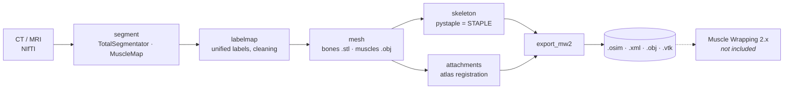

<div align="center">

# msk-pipe

**From a CT or MRI scan to the input of Muscle Wrapping 2.x — automatically.**

[](https://github.com/kivzcu/msk-pipe/actions/workflows/ci.yml)
[](https://github.com/kivzcu/msk-pipe/releases/latest)


[](#licence)

</div>

msk-pipe turns a lower-limb volume (`.nii` / `.nii.gz`) into a personalised hip model: bone and
muscle surfaces, an OpenSim skeletal model and muscle attachment areas, written exactly as
[Muscle Wrapping 2.x](https://doi.org/10.1007/s10439-020-02490-4) reads them. It replaces the
manual front end of the image-to-simulation workflow. GUI and command line, CPU or NVIDIA GPU.



| Output (`<run>/06_mw2_input/`) | |
|---|---|
| `bone_model.osim` | skeletal model (pelvis, femur, tibia; STAPLE joints) |
| `setup_MuscleGeneratorTool.xml`, `*.mot` | Muscle Wrapping setup and hip-flexion motion |
| `Geometry/*.obj`, `muscles/<muscle>/*.obj` | bone and muscle surfaces (closed, mm) |
| `muscles/<muscle>/*_Ori.vtk`, `*_Ins.vtk` | origin and insertion areas |

Every run folder also keeps the intermediate steps (`01_segment` … `05_attachments`) and a
`manifest.json` with versions, settings, timings and metrics.

---

## a) Just run it (Windows release)

No Python, MATLAB or OpenSim needed.

1. Download `msk-pipe-<version>-win64.zip` from
   [**Releases**](https://github.com/kivzcu/msk-pipe/releases/latest) (~1 GB).
2. *Properties → Unblock*, then extract to **`C:\`** (short path; *Extract all* suggests an
   extra folder level — remove it). You get `C:\msk-pipe-<version>\`.
3. Double-click **`msk-pipe.cmd`**. The first start unpacks the environment (1–3 min).
   SmartScreen: *More info → Run anyway*.
4. The **Setup…** window opens on the first start:
   - TotalSegmentator licence key (free for non-commercial use, for tibia/fibula) —
     or *Use MuscleMap instead*;
   - *GPU support* (optional, NVIDIA driver ≥ 570, ~3.5 GB).
5. Choose the volume, *Run*. Results: `Documents\msk-pipe\runs\<run>\06_mw2_input`.

Command line: `mskpipe.cmd run scan.nii.gz -m ct` · `mskpipe.cmd --help`.

| Where | What |
|---|---|
| the extracted folder | program and environment — delete it to uninstall |
| `%LOCALAPPDATA%\msk-pipe` | GPU support, MuscleMap weights, atlases |
| `%USERPROFILE%\.totalsegmentator` | TotalSegmentator weights and licence key |

## b) Build from source

Requires [pixi](https://pixi.sh) ≥ 0.60 and Git (Windows x64).

```powershell
winget install prefix-dev.pixi
git clone https://github.com/kivzcu/msk-pipe.git
cd msk-pipe
```

### ba) Dependencies resolved automatically

pixi installs the locked environment (`pixi.lock`) — Python, PyTorch, TotalSegmentator, MuscleMap,
VTK and [pystaple](https://github.com/PatrikMrnka/pystaple). MATLAB and OpenSim are not used;
Muscle Wrapping is not part of the pipeline.

```powershell
pixi run -e cpu gui                                  # GUI (CPU)
pixi run -e gpu gui                                  # GUI (CUDA 12.8)
pixi run -e cpu mskpipe run scan.nii.gz -m ct -d auto
pixi run -e cpu mskpipe setup licence <key>          # or --set segmentation.tibia_fibula=musclemap
```

### bb) Everything from source, verified

MuscleMap and pystaple are built from their pinned Git commits. pystaple reproduces MATLAB
STAPLE to 10⁻¹³ m, so MATLAB is not needed; the check runs in CI and locally:

```powershell
pixi run -e dev-cpu pytest tests/unit -q                       # unit tests
pixi run -e cpu python tools/skeleton_parity.py --fetch        # parity with MATLAB STAPLE
```

<details>
<summary>Build the Windows release package yourself</summary>

The same steps as the `build` job of [`release.yml`](.github/workflows/release.yml):

```powershell
function py { pixi exec --spec python=3.11 --spec pip --spec pyyaml python @args }
py packaging/build_release.py tools --out build/tools
py packaging/build_release.py wheels --out build/wheels
$inject = @(Get-ChildItem build/wheels/*.whl | ForEach-Object { "--inject"; $_.FullName })
build/tools/pixi-pack.exe --environment cpu --platform win-64 --ignore-pypi-non-wheel `
    --output-file build/environment.tar @inject pixi.toml
build/tools/pixi-unpack.exe build/environment.tar -o build/test -e env -s cmd -q
py packaging/build_release.py maxpath --root build/test --out build/maxpath.txt
build/test/env/python.exe packaging/collect_licenses.py --prefix build/test/env --out build/licenses
py packaging/build_release.py atlas --out build/assets
$version = py packaging/build_release.py version --wheels build/wheels
py packaging/build_release.py assemble --version $version --pack build/environment.tar `
    --unpack build/tools/pixi-unpack.exe --licenses build/licenses --maxpath build/maxpath.txt `
    --runtime-from build/test/env --out dist --atlas (Get-Item build/assets/*.zip).FullName
```

</details>

---

## Configuration and experiments

Every setting has a default and an explanation (`?` in the GUI). Priority: defaults < YAML <
`--set key=value`.

```powershell
mskpipe config init my.yaml                    # commented template
mskpipe run scan.nii.gz -c my.yaml --set skeleton.side=l --no-cache
mskpipe batch paper/experiments/e13_timing.yaml # repeated runs, parameter matrices
mskpipe stats runs -o stats                     # CSV tables: times, RAM, metrics per step
mskpipe qc runs/<run> --show                    # bone holes / gaps / bad meshes in 3D
```

## Troubleshooting

| Problem | Fix |
|---|---|
| `WinError 1455` / paging file too small | let Windows manage the page file, or `--set segmentation.totalsegmentator.nr_thr_saving=1` |
| No internet during the run | download weights beforehand: `mskpipe setup weights -m ct` |
| No TotalSegmentator licence key | *Use MuscleMap instead* (`--set segmentation.tibia_fibula=musclemap`) |
| Path too long | keep the release at a short path such as `C:\msk-pipe-<version>` |
| Warning "bone defect(s)" after the run | holes in thin bone or a broken fibula (common in MRI) were repaired or could not be: check them with `mskpipe qc <run> --show` (GUI: *Geometry check…*) |
| What is missing? | `mskpipe setup status` |

## Licence

| Component | Licence |
|---|---|
| msk-pipe source code | [Apache-2.0](LICENSE) |
| [pystaple](https://github.com/PatrikMrnka/pystaple) (bundled) | CC BY-NC 4.0 → **the pipeline and release are for non-commercial use only** ([NOTICE](NOTICE)) |
| Attachment atlas (`atlas/lhdl`, release asset) | CC BY-NC-SA 2.0 BE, derived from the LHDL dataset |
| Fast-RNRR (optional, *Setup… → Fast-RNRR*) | research use only, patented — not distributed, built on your PC on request |
| Other components, model weights | see [THIRD_PARTY_LICENSES.md](THIRD_PARTY_LICENSES.md) |

## Citation

Use **Cite this repository** ([`CITATION.cff`](CITATION.cff)) and the tools it builds on —
STAPLE, TotalSegmentator, MuscleMap ([THIRD_PARTY_LICENSES.md](THIRD_PARTY_LICENSES.md)) and,
with the bundled atlas, the LHDL project (`atlas/lhdl/README.md`). A journal article is in
preparation.

<sub>Patrik Mrnka, Josef Kohout · Department of Computer Science and Engineering, University of
West Bohemia in Pilsen · [Changelog](CHANGELOG.md)</sub>
